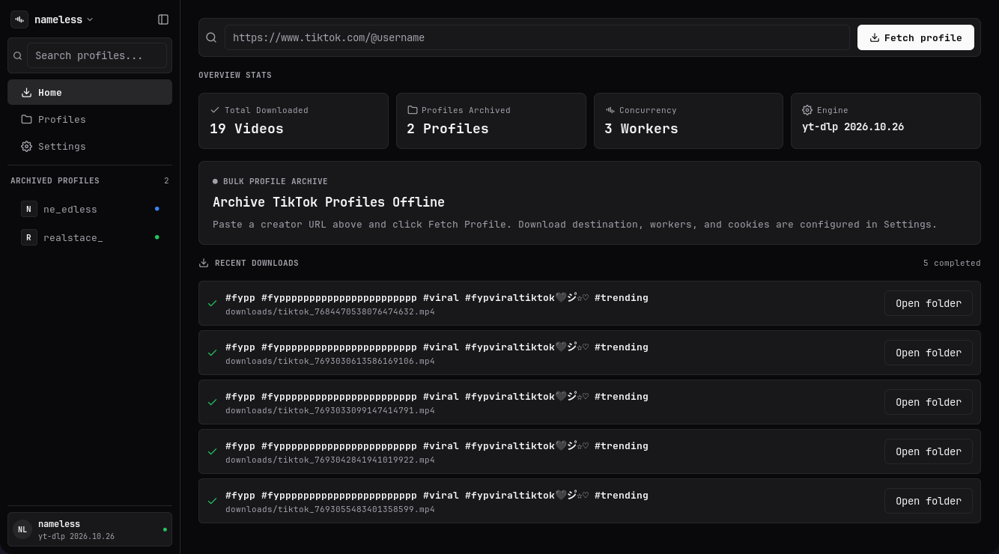
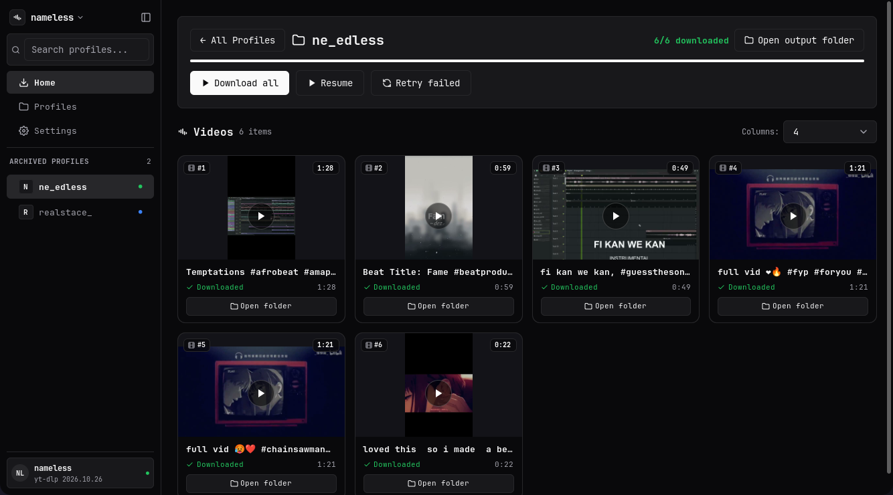
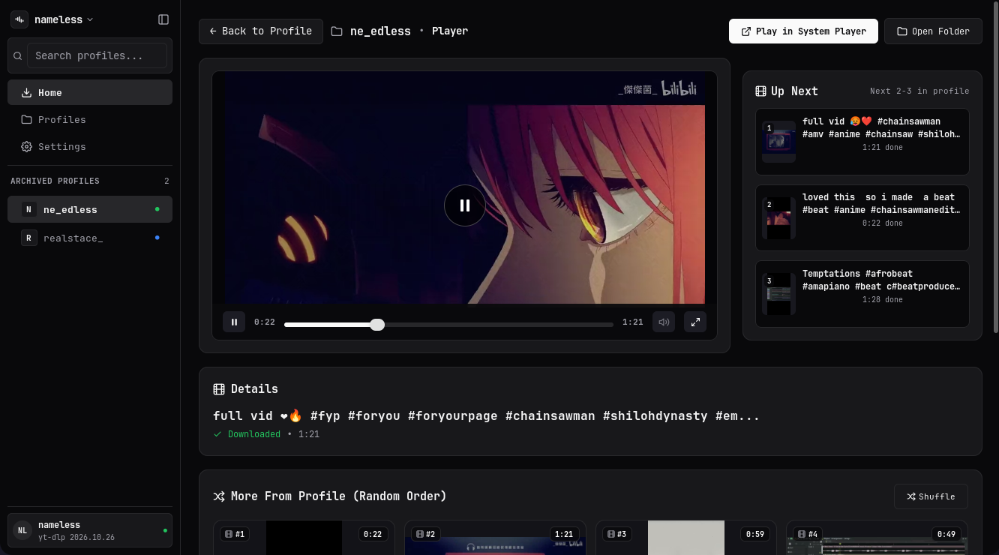
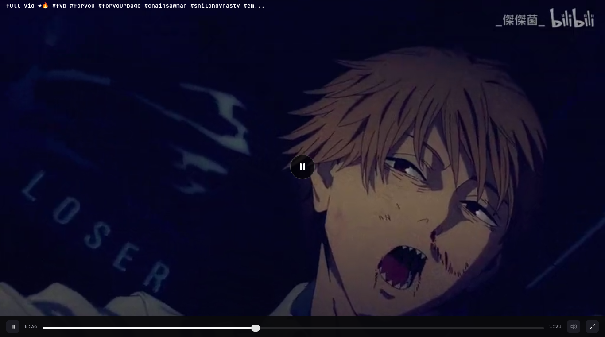
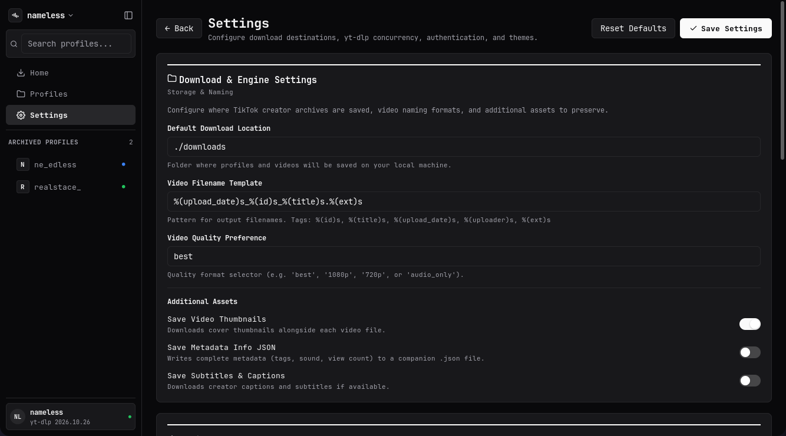

# nameless

**nameless** is a desktop bulk TikTok profile downloader powered by [`yt-dlp`](https://github.com/yt-dlp/yt-dlp) and built with Go and [`mygo`](https://github.com/egoist/mygo).

Unlike browser extensions or single-video downloaders, nameless is designed specifically for bulk archiving: paste a TikTok creator's profile URL, stream all their video metadata, and download entire profiles in parallel with live progress, pause/resume, and retry capabilities.

---

## Screenshots

| Home dashboard | Downloaded profile |
|:---:|:---:|
|  |  |

| In-app player | Fullscreen video mode |
|:---:|:---:|
|  |  |



*Settings — download destination, filename template, quality, additional assets, theme.*

---

## Features

- **Bulk Profile Downloading**: Fetch and download every video from a TikTok profile without manual per-video links.
- **SQLite-Backed State & True Resume**: Download progress, metadata, and status (`pending`, `downloading`, `paused`, `done`, `failed`) are persisted to a local SQLite database (`data.db`). Paused or interrupted downloads preserve `.part` files and cleanly resume with `yt-dlp`'s `--continue` mechanism.
- **Concurrent Worker Pool**: Configurable parallel workers (1–16 concurrent downloads) with staggered launch delays to avoid hitting rate limits.
- **Resilient Queue Controls**: Download all, pause in-flight downloads, resume unfinished runs, or retry only failed videos with a single click.
- **Built-In Video Player**: Watch downloaded videos without leaving the app — real playback with sound through the system's media engine (via `mygo`'s `ui/video`), play/pause, seek scrubber, mute toggle, "Up Next" queue, and a randomized "More From Profile" grid.
- **Fullscreen Video Mode**: One click expands the player to fullscreen video — window goes fullscreen and the app collapses to just the viewport with floating controls; `Escape` steps out.
- **Customizable Native UI**: Clean desktop interface with 6 built-in full-color themes — Shadcn (default), Catppuccin, Atom One, Dracula, Nord, and Tokyo Night — plus adjustable tokens (accent color hex, corner radius, spacing scale, dark mode toggle). Theme changes animate in live before you save.
- **yt-dlp Detection & Power Settings**: Automatic binary detection with version reporting, duration-based timeouts, custom output directory, and optional cookie/session authentication for private or restricted accounts. nameless can also download and manage its own yt-dlp copy.
- **Cross-Platform & Pure Go**: Runs natively on Linux, macOS, and Windows with zero CGO requirements (`CGO_ENABLED=0`).

---

## Prerequisites

### `yt-dlp`

nameless uses `yt-dlp` as its underlying download engine. `yt-dlp` must either be installed and accessible in your `PATH`, or you can let nameless download and manage its own copy (see the banner on the Home screen, or **Settings → Engine**).

### In-App Video Playback

The built-in player plays video through the system's own media framework (AVFoundation on macOS, Media Foundation on Windows, GStreamer on Linux):

- **Linux**: the player needs GStreamer 1.x installed and on at runtime:
  ```bash
  # Arch Linux
  sudo pacman -S gstreamer gst-plugins-base gst-plugins-good gst-libav
  # Debian / Ubuntu
  sudo apt install gstreamer1.0-plugins-base gstreamer1.0-plugins-good gstreamer1.0-libav
  # Fedora
  sudo dnf install gstreamer1-plugins-base gstreamer1-plugins-good gstreamer1-libav
  ```
  H.264/AAC MP4s (yt-dlp's default) require `gst-libav` or another H.264 decoder.
- **macOS / Windows**: no extra installs — the OS media frameworks are built in.

Without a media framework, nameless still shows thumbnails and the **Play in System Player** / **Open Folder** actions keep working.

### Installing `yt-dlp`

Choose the package manager for your operating system:

#### Linux
- **Arch Linux**:
  ```bash
  sudo pacman -S yt-dlp
  ```
- **Debian / Ubuntu**:
  ```bash
  sudo apt update && sudo apt install yt-dlp
  ```
- **Fedora**:
  ```bash
  sudo dnf install yt-dlp
  ```
- **Pip / pipx (Universal)**:
  ```bash
  pipx install yt-dlp
  ```

#### macOS
- **Homebrew**:
  ```bash
  brew install yt-dlp
  ```
- **MacPorts**:
  ```bash
  sudo port install yt-dlp
  ```

#### Windows
- **winget**:
  ```powershell
  winget install yt-dlp.yt-dlp
  ```
- **Scoop**:
  ```powershell
  scoop install yt-dlp
  ```
- **Chocolatey**:
  ```powershell
  choco install yt-dlp
  ```

Verify your installation:
```bash
yt-dlp --version
```

---

## Building from Source

### Requirements
- **Go**: 1.27 or later
- **mygo**: Tooling for native Go desktop applications (`github.com/egoist/mygo`)

### Build Commands

To build using `mygo`:
```bash
go tool mygo build
```

Alternatively, build directly with the standard Go toolchain (pure Go SQLite, no C compiler required):
```bash
CGO_ENABLED=0 go build -o nameless
```

### Running Tests

Run the test suite:
```bash
CGO_ENABLED=0 go test ./...
```

Run static analysis with `mygo vet`:
```bash
go tool mygo vet .
```

---

## Usage Guide

1. **Launch the application**:
   ```bash
   ./nameless
   ```
2. **Fetch a Profile**:
   - Paste a profile URL into the **Profile URL** field (e.g., `https://www.tiktok.com/@username`).
   - Specify or confirm your **Save to** destination folder.
   - Click **Fetch profile**. nameless streams video entries via `yt-dlp` without buffering everything in memory.
3. **Download Videos**:
   - After fetching, you are navigated to the profile view showing the list of videos.
   - Click **Download all** to queue downloads across the worker pool.
   - Track live percentage and byte progress for each video.
   - Use **Pause** to suspend active downloads, **Resume** to continue, or **Retry failed** to re-queue any errored items.
4. **Watch Your Archive**:
   - Click a video card (cover or title) to open the built-in **Player** page.
   - Playback starts automatically with sound. Controls on the video: play/pause, a seekable scrubber, elapsed/total time, and a mute toggle. `Space` also toggles play/pause.
   - The **Up Next** panel lists the following videos in the profile; "More From Profile" shows the rest in a randomized grid (**Shuffle** re-rolls it).
   - Click the expand button (or use the controls bar) for **fullscreen video mode** — the whole window becomes the player; press `Escape` to step back out.
   - Prefer your own player? Use **Play in System Player** (mpv/fallback) or **Open Folder** at any time.
5. **Settings**:
   - Click **Settings** from the main screen to customize theme colors, corner radiuses, and worker concurrency.
   - Configure session cookies (`Cookie`, `SessionID`, or path to an env file) if downloading from accounts requiring authentication.
   - Click **Detect** to refresh `yt-dlp` binary detection and version display.

---

## Configuration (`config.json`)

Settings are persisted in `config.json` in the application directory. You can adjust settings through the in-app Settings screen or by editing `config.json` directly:

```json
{
  "cookie": "",
  "session_id": "",
  "env_file": ".env",
  "default_download_location": "./downloads",
  "workers": 3,
  "delay": "1s",
  "per_video_timeout": "5m0s",
  "theme": {
    "preset": "Shadcn",
    "accent": "#fafafa",
    "dark": true,
    "radius": 8,
    "spacing": 4
  }
}
```

### Key Settings

| Field | Description | Default |
|---|---|---|
| `workers` | Number of concurrent download workers (1–16). | `3` |
| `delay` | Delay between launching consecutive downloads (prevents aggressive rate limits). | `1s` |
| `per_video_timeout` | Maximum timeout before killing a stalled video download process. | `5m` |
| `default_download_location` | Default folder path where videos are saved. | System default |
| `theme.preset` | Named color scheme: `Shadcn`, `Catppuccin`, `Atom One`, `Dracula`, `Nord`, or `Tokyo Night` (unknown names fall back to `Shadcn`). In dark mode the preset recolors the whole window; light mode keeps the zinc light chrome and takes the accent + semantic colors. | `Shadcn` |
| `theme.accent` | Primary accent color in hex (`#rrggbb`). | `#fafafa` |
| `theme.dark` | Dark mode toggle (`true` / `false`). | `true` |
| `theme.radius` | UI element corner radius (4–16 DIP). | `8` |
| `theme.spacing` | Layout spacing unit (3 = Compact, 4 = Default, 5 = Roomy). | `4` |

---

## Data Storage

nameless stores profile history and video download progress in a SQLite database located at:
- **Linux**: `~/.config/nameless/data.db`
- **macOS**: `~/Library/Application Support/nameless/data.db`
- **Windows**: `%APPDATA%\nameless\data.db`

---

## License

This project is licensed under the MIT License. See `LICENSE` for details.
